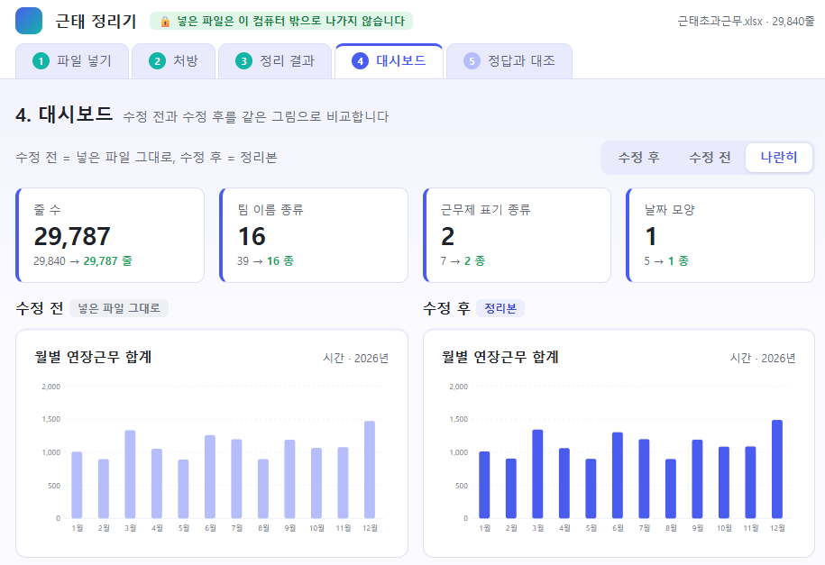

# 근태 정리기

## 쓰기 전에
1. **넣은 파일은 이 브라우저를 떠나지 않습니다.** 계산은 전부 브라우저 안에서 하며, 확인하려면 F12 → Network 탭을 열고 정리해 보세요. 파일 내용을 보내는 요청은 없고, 처방 파일(`rules/…json`)을 읽는 요청만 보입니다.
2. **이 정리기가 못 하는 것이 있습니다.** 틀렸는지 확실하지 않은 값은 고치지 않고 `_표시` 칸에 까닭만 적습니다. 시간 값이 계산값과 0.05시간(3분) 안으로만 다르면 표시도 하지 않습니다. 지어낸 파일 한 개를 정답과 맞춰 본 결과 어긋난 595줄이 모두 표시됐지만(허용오차를 0.25시간으로 두었을 때는 4줄을 놓쳤습니다), 다른 파일에서도 그런지는 미확인입니다.
3. **무엇을 고칠지는 `rules/` 의 파일에 있습니다.** 처방을 바꾸려면 `rules/근태초과근무.json` 을 고치세요. 코드에는 처방이 없습니다.

## 하는 일
근태·초과근무 엑셀(18칸 양식)을 끌어다 놓으면 처방대로 정리해 **정리본**과 **바꾼 기록**을 엑셀로 내려 줍니다. 정리 전과 후를 대시보드로 비교하고, 정답 파일이 있으면 어디가 다른지 대조할 수 있습니다.

1. **파일 넣기** — `.xlsx` 를 끌어다 놓습니다. (예시: `data/근태초과근무.xlsx`, 지어낸 데이터입니다)
2. **처방** — 파일 이름과 같은 `rules/<파일이름>.json` 을 읽어 처방과 이유를 보여 주고, **규칙대로 정리**를 누릅니다. 맞는 처방 파일이 없으면 직접 골라 올릴 수 있습니다.
3. **정리 결과** — 줄 수 전후, 고친 값, 표시한 줄, 지운 줄을 확인하고 정리본·바꾼 기록을 받습니다.
4. **대시보드** — 수정 전 · 수정 후 · 나란히 보기.
5. **정답과 대조** — 내 컴퓨터에서 정답 파일을 골라 맞춰 봅니다.

## 원칙
- 확실한 것만 고칩니다(표기 통일 등). 틀렸는지 알 수 없는 값은 **고치지 않고 표시**합니다.
- **줄을 삭제하지 않습니다.** 빠지는 줄은 `제외` 시트에 모읍니다.
- 같은 파일은 몇 번을 돌려도 같은 결과가 나옵니다(화면에서 5번 돌려 확인).

## 구성
| 파일·폴더 | 역할 |
|---|---|
| `index.html` `style.css` | 화면 |
| `app.js` | 화면 동작(파일 읽기, 단계 이동, 내려받기, 정답 대조) |
| `clean.js` | 정리 엔진(처방 파일의 «종류»대로 실행) |
| `charts.js` `dashboard.js` | 대시보드 그림 |
| `lib/` | 엑셀을 읽고 쓰는 SheetJS(0.20.3, Apache-2.0, 라이선스 포함) |
| `rules/` | 처방 파일 |
| `data/` | 지어낸 예시 엑셀 |

## 열어 보기
`index.html` 을 웹 주소로 열어야 처방 파일을 자동으로 읽습니다. 내 컴퓨터에서는 이 폴더에서 `python -m http.server 8000` 을 실행하고 `http://localhost:8000` 을 여세요. (파일을 더블클릭해 열면 처방 파일을 직접 골라야 합니다.)
